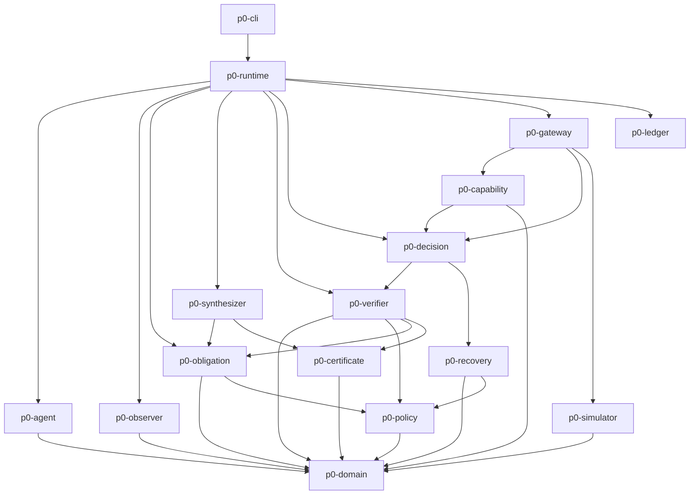

# Diagrama de dependências

## Dependências proibidas

- `p0-agent -> p0-gateway`
- `p0-agent -> p0-capability`
- `p0-synthesizer -> p0-gateway`
- `p0-ledger -> p0-decision`
- `p0-cli -> p0-simulator`
